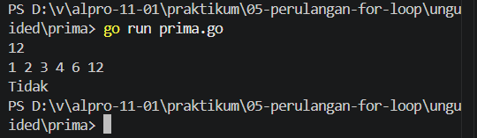
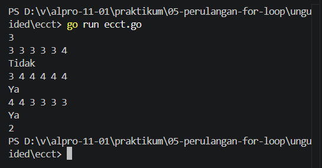

# <h1 align="center">Laporan Praktikum Modul [5] - [Perulangan For Loop]</h1>

[Varel Dwi Putra] - [109092600024]

## Dasar Teori

### A. Perulangan (Looping)
Perulangan (looping) merupakan struktur kontrol yang digunakan untuk mengeksekusi suatu blok kode secara berulang selama kondisi tertentu terpenuhi. Perulangan dapat digunakan untuk menyelesaikan permasalahan yang membutuhkan proses berulang, seperti menghitung total nilai, mencari bilangan terbesar, dan memeriksa faktor suatu bilangan.

### B. Perulangan For pada Bahasa Go
Bahasa pemrograman Go (Golang) hanya menyediakan satu kata kunci untuk perulangan, yaitu for. Kata kunci ini dapat digunakan dalam beberapa bentuk sesuai dengan kebutuhan algoritma. Pada praktikum Modul 05, perulangan for digunakan untuk menjalankan instruksi secara berulang berdasarkan jumlah iterasi maupun kondisi tertentu.

#### 1. For dengan Tiga Komponen
Bentuk ini terdiri atas tiga komponen, yaitu inisialisasi, kondisi, dan post statement atau pembaruan. Inisialisasi digunakan untuk menentukan nilai awal variabel, kondisi menentukan apakah perulangan dilanjutkan, sedangkan post statement digunakan untuk memperbarui nilai variabel pada setiap iterasi.

#### ​2. For dengan Kondisi
Bentuk ini hanya menggunakan kondisi sebagai penentu berlangsungnya perulangan. Perulangan akan terus dijalankan selama kondisi bernilai benar. Bentuk ini memiliki fungsi yang menyerupai while pada bahasa pemrograman lain.

### 3. For Tanpa Kondisi
Bentuk for tanpa kondisi akan menjalankan perulangan secara terus-menerus hingga dihentikan menggunakan mekanisme tertentu, misalnya pernyataan break ketika kondisi yang ditentukan terpenuhi.

### 4. For-Range
for-range digunakan untuk melakukan iterasi terhadap elemen suatu koleksi data, seperti array, slice, string, atau map. Dalam iterasi array atau slice, bentuk ini dapat menghasilkan indeks dan nilai elemen yang sedang diproses.

### C. Perulangan Bersarang (Nested For-Loop)
Perulangan bersarang merupakan struktur perulangan for yang berada di dalam perulangan for lainnya. Struktur ini dapat digunakan untuk memproses data dalam bentuk baris dan kolom, membuat pola karakter, serta menyelesaikan permasalahan yang memerlukan lebih dari satu tingkat perulangan.

### D. Penggunaan Perulangan dalam Penyelesaian Masalah
Perulangan for dapat diterapkan untuk berbagai penyelesaian masalah algoritmik. Pada praktikum ini, penerapannya meliputi penghitungan total tabungan, pencarian bilangan terbesar, penghitungan harga tiket bioskop, penentuan faktor dan bilangan prima, serta pemeriksaan kelayakan mahasiswa memperoleh sertifikat berdasarkan rata-rata nilai tes.

## Guided

### 1. tabungan.go

package main

import "fmt"

func main() {
	var a, b, n int
	fmt.Scan(&a, &b, &n)

	total := 0
	tabunganHariIni := a

	for i := 1; i <= n; i++ {
		total = total + tabunganHariIni
		tabunganHariIni = tabunganHariIni + b
	}
	fmt.Println(total)
}

#### Deskripsi
Program yang dibuat untuk menghitung total tabungan Budi setelah n hari. 

### 2. terbesar.go

package main

import "fmt"

func main() {
	var n int
	fmt.Scan(&n)

	var angka, max int
	fmt.Scan(&angka)

	for i := 2; i < n; i++ {
		fmt.Scan(&angka)

		if angka > max {
			max = angka
		}
	}
	fmt.Println(max)
}

#### Deskripsi
Program yang dibuat untuk mencari bilangan terbesar dari n buah bilangan bulat yang diinputkan menggunakan perulangan for. 

### 3. bioskop.go

package main

import "fmt"

func main() {
	var t int
	fmt.Print("input t (jumlah transaksi): ")
	fmt.Scan(&t)

	totalPendapatan := 0

	for i := 1; i <= t; i++ {
		var jenisFilm, hari string
		var jumlahTiket int

		fmt.Printf("input transaksi ke-%d (jenis, hari, tiket): ", i)
		fmt.Scan(&jenisFilm, &hari, &jumlahTiket)

		hargaSatuan := 0

		if jenisFilm == "Reguler" {
			if hari == "Senin" || hari == "Selasa" || hari == "Rabu" || hari == "Kamis" {
				hargaSatuan = 40000
			} else {
				hargaSatuan = 50000
			}
		} else if jenisFilm == "3D" {
			if hari == "Senin" || hari == "Selasa" || hari == "Rabu" || hari == "Kamis" {
				hargaSatuan = 60000
			} else {
				hargaSatuan = 70000
			}
		} else if jenisFilm == "IMAX" {
			if hari == "Senin" || hari == "Selasa" || hari == "Rabu" || hari == "Kamis" {
				hargaSatuan = 80000
			} else {
				hargaSatuan = 90000
			}
		}

		totalHarga := hargaSatuan * jumlahTiket

		if jumlahTiket >= 5 {
			diskon := (totalHarga * 10) / 100
			totalHarga = totalHarga - diskon
		}

		fmt.Printf("output total harga transaksi ke-%d: %d\n", i, totalHarga)

		totalPendapatan = totalPendapatan + totalHarga
	}

	fmt.Println("output total pendapatan:", totalPendapatan)
}

### Deskripsi
Program yang membaca sejumlah transaksi, lalu untuk setiap transaksi menghitung total harga berdasarkan jenis film, hari pemutaran, dan jumlah tiket yang dibeli. Jika pembelian dalam satu transaksi ≥ 5 tiket, pelanggan mendapatkan diskon 10% dari total harga transaksi tersebut.

## Unguided

### 1. Prima

package main

import "fmt"

func main() {
	var n int
	fmt.Scan(&n)

	jumlah := 0
	for i := 1; i <= n; i++ {
		if n%i == 0 {
			if jumlah > 0 {
				fmt.Print(" ")
			}
			fmt.Print(i)
			jumlah++
		}
	}
	fmt.Println()

	if jumlah == 2 {
		fmt.Println("Ya")
	} else {
		fmt.Println("Tidak")
	}
}

##### Output

#### Deskripsi
Program yang dibuat untuk menampilkan seluruh faktor dari sebuah bilangan bulat positif n, kemudian menentukan apakah n merupakan bilangan prima atau bukan.

### 2. Ecct

package main

import "fmt"

func main() {
	var m, nilai, lulus int
	fmt.Scan(&m)

	for i := 0; i < m; i++ {
		jumlah := 0
		for j := 0; j < 6; j++ {
			fmt.Scan(&nilai)
			jumlah += nilai
		}

		rata := float64(jumlah) / 6
		if rata >= 3.33 {
			fmt.Println("Ya")
			lulus++
		} else {
			fmt.Println("Tidak")
		}
	}
	fmt.Println(lulus)
}

##### Output

#### Deskripsi
Program yang dibuat untuk menentukan apakah setiap mahasiswa baru Tel-U dalam satu kelompok bisa mendapat sertifikat ECCT atau tidak. Syarat mendapat sertifikat ECCT adalah rata-rata nilai tes ECCT minimal 3.33. Selain itu, program juga menghitung berapa banyak mahasiswa yang mendapat sertifikat. 

## Kesimpulan
Berdasarkan praktikum Modul 05, perulangan for dalam bahasa Go berhasil diterapkan untuk menyelesaikan berbagai permasalahan algoritmik. Perulangan digunakan untuk menghitung total tabungan, mencari bilangan terbesar, menghitung harga tiket bioskop, menentukan faktor dan bilangan prima, serta memeriksa kelayakan mahasiswa dalam memperoleh sertifikat ECCT. Melalui praktikum ini, penggunaan perulangan for, variabel penghitung, kondisi, dan percabangan dapat dipahami sebagai bagian penting dalam membangun program yang terstruktur dan efisien. 

## Referensi

1. Laboratorium Praktikum Informatika. (2025). Modul 05: Perulangan For Loop – Bahasa Pemrograman Go (Golang). Bandung: Fakultas Informatika, Universitas Telkom.

2. Laboratorium Praktikum Informatika. (2026). Bahan Ajar Praktikum: Perulangan For Loop Go. Fakultas Informatika, Universitas Telkom.

3. Laboratorium Praktikum Informatika. (2025/2026). Jurnal Tugas Praktikum Modul 05: Algoritma dan Pemrograman – Perulangan For. Program Studi S1 Rekayasa Perangkat Lunak, Universitas Telkom.