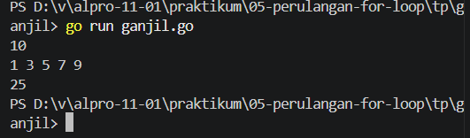
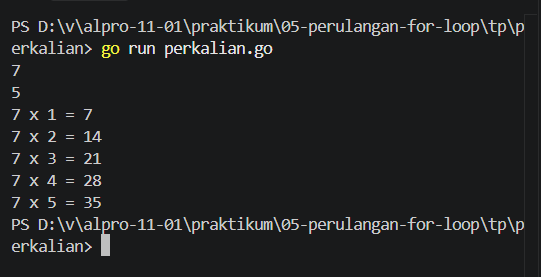

# <h1 align="center">Tugas Pendahuluan Modul [5] - [Perulangan For Loop]</h1>

[Varel Dwi Putra] - [109092600024]

### 1. Fungsi perulangan for dan tiga komponennya

Perulangan for berfungsi untuk menjalankan perintah secara berulang selama kondisi yang ditentukan masih terpenuhi. Dengan perulangan, kita tidak perlu menulis perintah yang sama berkali-kali.

Tiga komponennya adalah:
1. Inisialisasi, yaitu menentukan nilai awal variabel yang digunakan dalam perulangan.
2. Kondisi, yaitu menentukan apakah perulangan akan terus dijalankan atau berhenti.
3. Post statement, yaitu memperbarui nilai variabel setiap kali perulangan selesai dijalankan misalnya menggunakan i++ untuk menambah nilai satu.

### 2. Perbedaan for tiga komponen dan for dengan kondisi

for dengan tiga komponen memiliki inisialisasi, kondisi, dan post statement dalam satu baris. Bentuk ini biasanya digunakan jika jumlah perulangan sudah ditentukan.

### 3. Ganjil
package main

import "fmt"

func main() {
	var n int
	fmt.Scan(&n)

	jumlah := 0

	for i := 1; i <= n; i += 2 {
		fmt.Print(i, " ")
		jumlah += i
	}

	fmt.Println()
	fmt.Println(jumlah)
}

### output

#### Deskripsi
Program yang menggunakan perulangan for untuk menampilkan semua bilangan ganjil dari 1 hingga n, kemudian menampilkan jumlah seluruh bilangan ganjil tersebut. 

### 4. Perkalian

package main

import "fmt"

func main() {
    var a, b int
    fmt.Scan(&a, &b)

    for i := 1; i <= b; i++ {
        fmt.Println(a, "x", i, "=", a*i)
    }
}

##### Output

#### Deskripsi
 Program yang menggunakan perulangan for untuk menampilkan tabel perkalian dari sebuah bilangan a, mulai dari a × 1 hingga a × b. 

## Kesimpulan
Berdasarkan tugas pendahuluan Modul 05, perulangan "for" pada bahasa Go dapat digunakan untuk menjalankan perintah secara berulang sesuai kondisi yang ditentukan. Melalui soal yang dikerjakan, perulangan "for" dapat digunakan untuk menampilkan bilangan ganjil beserta jumlahnya dan membuat tabel perkalian. Dengan menggunakan perulangan, program menjadi lebih praktis karena tidak perlu menuliskan perintah yang sama berulang kali.