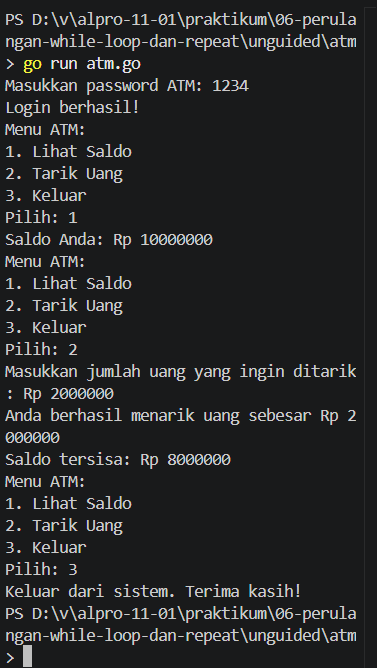

# <h1 align="center">Laporan Praktikum Modul [6] - [Perulangan While]</h1>

[Varel Dwi Putra] - [109092600024]

## Dasar Teori

### A. Perulangan (Looping)
Perulangan adalah struktur yang digunakan untuk menjalankan perintah secara berulang selama kondisi tertentu masih terpenuhi. Perulangan biasanya digunakan ketika suatu proses perlu dilakukan beberapa kali, seperti menghitung nilai atau memeriksa data.

### B. Perulangan While pada Bahasa Go
Bahasa Go tidak memiliki kata kunci "while" secara langsung. Perulangan while dapat ditulis menggunakan "for" yang hanya memiliki kondisi. Perulangan akan terus berjalan selama kondisi bernilai benar dan berhenti ketika kondisi bernilai salah.

### 1. Cara Kerja While
Pada perulangan while, kondisi diperiksa terlebih dahulu sebelum perintah dijalankan. Jika kondisi bernilai benar, perulangan akan berjalan. Namun, jika kondisi bernilai salah sejak awal, perintah di dalam perulangan tidak akan dijalankan.

### 2. Implementasi While dalam Go
Dalam bahasa Go, perulangan while menggunakan kata kunci "for" diikuti kondisi.

### C. Perulangan Repeat-Until
Repeat-until merupakan perulangan yang menjalankan perintah terlebih dahulu, kemudian memeriksa kondisi untuk menentukan apakah perulangan harus berhenti. Oleh karena itu, perintah di dalam perulangan pasti dijalankan minimal satu kali.

### 1. Cara Kerja Repeat-Until

Pada repeat-until, perintah dijalankan terlebih dahulu sebelum kondisi diperiksa. Perulangan akan berhenti ketika kondisi berhenti sudah terpenuhi.

### 2. Implementasi Repeat-Until dalam Go
Bahasa Go tidak menyediakan kata kunci "repeat-until" secara langsung. Bentuk ini dapat dibuat menggunakan "for" dan variabel kondisi yang diperbarui di dalam perulangan.

### D. Perbedaan While dan Repeat-Until
While memeriksa kondisi sebelum menjalankan perintah, sedangkan repeat-until menjalankan perintah terlebih dahulu sebelum memeriksa kondisi berhenti. Perbedaan ini membuat while bisa tidak dijalankan sama sekali, sedangkan repeat-until dijalankan minimal satu kali.

### E. Penggunaan Perulangan dalam Program
Perulangan dapat digunakan untuk menyelesaikan berbagai masalah dalam pemrograman, seperti mencari bilangan yang memenuhi syarat tertentu, menghitung jumlah huruf vokal dalam kalimat, dan membuat menu ATM. Dalam penggunaannya, kondisi dan perubahan nilai variabel harus diperhatikan agar perulangan dapat berhenti sesuai kebutuhan.

## Guided

### 1. Terkecil.go

package main

import "fmt"

func main() {
	var batas int
	fmt.Scan(&batas)

	n := 1
	for n*n*n <= batas {
		n++
	}

	fmt.Println(n)
}

#### Deskripsi
Program yang menggunakan perulangan while (for kondisi) untuk mencari bilangan bulat terkecil n sehingga n³ (n pangkat 3) lebih besar dari 12000. Program harus menghitung nilai n mulai dari 1 ke atas hingga menemukan bilangan terkecil n yang memenuhi syarat tersebut.  

### 2. Terbesar.go

package main

import "fmt"

func main() {
	var batas int
	fmt.Scan(&batas)

	n := 1
	for n*n < batas {
		n++
	}

	fmt.Println(n - 1)
}

#### Deskripsi
 Program yang menggunakan perulangan while (for kondisi) untuk menemukan bilangan bulat terbesar n sedemikian rupa sehingga n² kurang dari batas yang diinputkan. Program harus mencari bilangan n yang memenuhi kondisi tersebut dan menampilkan nilai n terbesar yang memenuhi syarat. 

### 3. bioskop.go

package main

import (
	"bufio"
	"fmt"
	"os"
	"strings"
)

func main() {
	reader := bufio.NewReader(os.Stdin)
	kalimat, _ := reader.ReadString('\n')

	i := 0
	jumlahVokal := 0

	for i < len(kalimat) {
		ch := strings.ToLower(string(kalimat[i]))
		if ch == "a" || ch == "i" || ch == "u" || ch == "e" || ch == "o" {
			jumlahVokal++
		}
		i++
	}

	fmt.Println(jumlahVokal)
}

### Deskripsi
Program yang meminta pengguna memasukkan sebuah kata atau kalimat. Program akan menghitung berapa banyak huruf vokal (a, i, u, e, o) yang terdapat dalam kata atau kalimat tersebut, baik huruf kecil maupun huruf kapital. Program harus menggunakan perulangan while (for kondisi) dengan indeks untuk memeriksa setiap karakter dan berhenti setelah semua karakter dalam string diperiksa. 

## Unguided

### 1. ATM

package main

import "fmt"

func main() {
    password := ""
    kesempatan := 0
    saldo := 10000000

    for password != "1234" && kesempatan < 3 {
        fmt.Print("Masukkan password ATM: ")
        fmt.Scan(&password)

        if password != "1234" {
            fmt.Println("Password salah. Silakan coba lagi.")
            kesempatan++
        }
    }

    if password != "1234" {
        fmt.Println("ATM terblokir. Program selesai.")
    } else {
        fmt.Println("Login berhasil!")

        pilihan := 0

        for pilihan != 3 {
            fmt.Println("Menu ATM:")
            fmt.Println("1. Lihat Saldo")
            fmt.Println("2. Tarik Uang")
            fmt.Println("3. Keluar")
            fmt.Print("Pilih: ")
            fmt.Scan(&pilihan)

            if pilihan == 1 {
                fmt.Println("Saldo Anda: Rp", saldo)
            } else if pilihan == 2 {
                var tarik int

                fmt.Print("Masukkan jumlah uang yang ingin ditarik: Rp ")
                fmt.Scan(&tarik)

                if tarik > 0 && tarik <= saldo {
                    saldo = saldo - tarik
                    fmt.Println("Anda berhasil menarik uang sebesar Rp", tarik)
                    fmt.Println("Saldo tersisa: Rp", saldo)
                } else {
                    fmt.Println("Saldo tidak mencukupi.")
                }
            } else if pilihan == 3 {
                fmt.Println("Keluar dari sistem. Terima kasih!")
            }
        }
    }
}

##### Output

#### Deskripsi
 Program yang dibuat untuk simulasi sistem ATM dengan skenario sebagai berikut:

 • Program meminta pengguna memasukkan password ATM untuk mengakses sistem. 

 • Pengguna diberikan maksimal 3 kesempatan untuk memasukkan password yang benar. 

 • Jika password benar, program menampilkan Menu ATM dengan pilihan untuk melihat saldo, menarik uang, atau keluar. Menu terus ditampilkan hingga pengguna memilih keluar. 

 • Jika pengguna salah memasukkan password sebanyak 3 kali berturut-turut, program menampilkan pesan bahwa ATM terblokir dan program berakhir.

 • Password ATM yang benar adalah "1234". • Inisialisasi saldo awal dengan 10000000

## Kesimpulan
Berdasarkan praktikum Modul 06, saya mempelajari penggunaan perulangan while dalam bahasa Go yang ditulis menggunakan "for" dengan kondisi. Perulangan ini dapat digunakan untuk mencari bilangan tertentu, menghitung huruf vokal, dan membuat menu ATM sederhana. Dari praktikum ini, saya lebih memahami cara menggunakan kondisi dan memperbarui nilai agar perulangan berjalan sesuai kebutuhan dan dapat berhenti pada waktunya.

## Referensi
1. Laboratorium Praktikum Informatika. Modul 6: Logika Perulangan (While & Repeat-Until). Bahan ajar Algoritma dan Pemrograman.
2. Laboratorium Praktikum Informatika. Jurnal Modul 06: Perulangan While – Bahasa Pemrograman Go (Golang). Fakultas Informatika, Universitas Telkom.