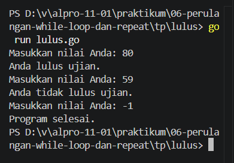
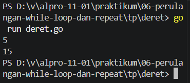
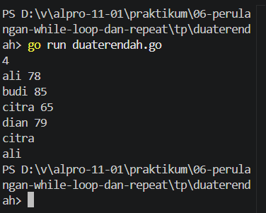
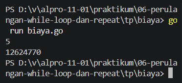

# <h1 align="center">Tugas Pendahuluan Modul [6] - [Perulangan While]</h1>

[Varel Dwi Putra] - [109092600024]

### 1. Lulus

package main

import "fmt"

func main() {
    var nilai int

    for {
        fmt.Print("Masukkan nilai Anda: ")
        fmt.Scan(&nilai)

        if nilai == -1 {
            break
        }

        if nilai >= 60 {
            fmt.Println("Anda lulus ujian.")
        } else {
            fmt.Println("Anda tidak lulus ujian.")
        }
    }

    fmt.Println("Program selesai.")
}

### output

### Deskripsi
Program meminta pengguna (siswa) memasukkan nilai ujian mereka secara berulang. Jika nilai yang dimasukkan lebih besar atau sama dengan 60, tampilkan pesan Anda lulus ujian. Jika tidak, tampilkan pesan Anda tidak lulus ujian.

### 2. Deret

package main

import "fmt"

func main() {
    var n int
    fmt.Scan(&n)

    i := 1
    jumlah := 0

    for i <= n {
        jumlah = jumlah + i
        i++
    }

    fmt.Println(jumlah)
}

### output

### Deskripsi
Program ini dibuat untuk menghitung jumlah dari deret bilangan berikut menggunakan perulangan while

### 3. Duaterendah

package main

import "fmt"

func main() {
    var n int
    fmt.Scan(&n)

    var nama string
    var nilai int

    var nama1, nama2 string
    nilai1 := 1000000
    nilai2 := 1000000

    i := 1
    for i <= n {
        fmt.Scan(&nama, &nilai)

        if nilai < nilai1 {
            nilai2 = nilai1
            nama2 = nama1

            nilai1 = nilai
            nama1 = nama
        } else if nilai < nilai2 {
            nilai2 = nilai
            nama2 = nama
        }

        i++
    }

    fmt.Println(nama1)
    fmt.Println(nama2)
}

### output

### Deskripsi
Program yang menggunakan perulangan while untuk menemukan dua nilai terendah dari n siswa.

### 4. Biaya

package main

import "fmt"

func main() {
    var n int
    fmt.Scan(&n)

    biaya := 10000000.0
    tahun := 1

    for tahun < n {
        biaya = biaya * 1.06
        tahun++
    }

    fmt.Printf("%.0f\n", biaya)
}

### output

### Deskripsi
Program yang dibuat untuk membantu sebuah universitas menghitung perkiraan biaya kuliah setiap tahun sampai tahun ke-n. Biaya kuliah awal pada universitas tersebut adalah Rp 10.000.000 dan setiap tahun bertambah sebesar 6% dari biaya tahun sebelumnya. 

## Kesimpulan
Berdasarkan tugas pendahuluan Modul 06, perulangan "while" dalam bahasa Go dapat dibuat menggunakan "for" dengan kondisi. Perulangan ini dapat digunakan untuk memeriksa nilai ujian, menghitung jumlah deret bilangan, mencari dua nilai terendah siswa, dan menghitung perkiraan biaya kuliah setiap tahun. Dari soal-soal tersebut, saya memahami bahwa perulangan membantu menjalankan proses secara berulang sampai kondisi yang ditentukan terpenuhi.
