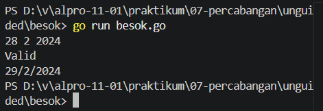

# <h1 align="center">Laporan Praktikum Modul [7] - [Perulangan While]</h1>

[Varel Dwi Putra] - [109092600024]

## Dasar Teori

### A. Struktur Percabangan
Percabangan merupakan struktur kontrol yang digunakan untuk menentukan perintah yang akan dijalankan berdasarkan kondisi tertentu. Dengan percabangan, program dapat memberikan hasil yang berbeda sesuai dengan nilai atau kondisi yang dimasukkan oleh pengguna.

### B. Percabangan if-else pada Go
Percabangan "if-else" digunakan untuk memeriksa suatu kondisi. Jika kondisi bernilai benar, maka perintah di dalam "if" akan dijalankan. Jika kondisi salah, program akan menjalankan perintah di dalam "else".

### 1. Percabangan if
"if" digunakan untuk menjalankan perintah jika kondisi yang diberikan bernilai benar.

### 2. Percabangan if-else
"if-else" digunakan untuk memilih antara dua kondisi, yaitu ketika kondisi benar dan ketika kondisi salah.

### 3. Percabangan else-if
"else-if" digunakan untuk memeriksa beberapa kondisi secara berurutan sampai ditemukan kondisi yang sesuai.

### 4. Nested if
Nested if merupakan percabangan yang berada di dalam percabangan lainnya. Bentuk ini digunakan ketika suatu kondisi perlu diperiksa lagi berdasarkan kondisi sebelumnya.

### C. Percabangan Switch-Case
"switch-case" digunakan untuk memilih salah satu perintah berdasarkan nilai yang sesuai dengan case. Struktur ini membuat program lebih mudah dibaca ketika terdapat banyak pilihan kondisi.

### 1. Case
"case" digunakan untuk menentukan nilai atau kondisi yang akan diperiksa oleh switch.

### 2. Default
"default" dijalankan jika tidak ada nilai yang sesuai dengan case yang tersedia.

### D. Operator dalam Percabangan
Dalam membuat kondisi percabangan, terdapat beberapa operator yang digunakan untuk membandingkan nilai.

### 1. Operator Perbandingan
Operator perbandingan digunakan untuk membandingkan dua nilai, seperti "==", "!=", ">", "<", ">=", dan "<=".

### 2. Operator Logika
Operator logika digunakan untuk menggabungkan beberapa kondisi. Dalam Go terdapat operator "&&" yang berarti AND, "||" yang berarti OR, dan "!" yang berarti NOT.

### E. Penerapan Percabangan dalam Program
Percabangan dapat digunakan dalam berbagai program, seperti menentukan tahun kabisat, jenis segitiga, kalkulator sederhana, menghitung ongkos kirim, memeriksa tanggal, dan menghitung tarif parkir. Dengan menggunakan percabangan, program dapat mengambil keputusan sesuai dengan kondisi yang telah ditentukan.

## Guided

### 1. Kabisat.go

package main

import "fmt"

func main() {
	var tahun int
	fmt.Scan(&tahun)

	if (tahun%400 == 0) || (tahun%4 == 0 && tahun%100 != 0) {
		fmt.Println("Ya")
	} else {
		fmt.Println("Tidak")
	}
}

#### Deskripsi
Program dalam bahasa Go yang dibuat untuk menentukan apakah sebuah tahun merupakan tahun kabisat atau bukan.

### 2. Segitiga.go

package main

import "fmt"

func main() {
	var a, b, c int
	fmt.Scan(&a, &b, &c)

	if a <= 0 || b <= 0 || c <= 0 || a+c <= b || b+c <= a || a+b <= c {
		fmt.Println("Bukan Segitiga")
	} else if a == b && b == c {
		fmt.Println("Segitiga Sama Sisi")
	} else if a == b || a == c || c == b {
		fmt.Println("Segitiga Sama Kaki")
	} else {
		fmt.Println("Segitiga Sembarang")
	}
}

#### Deskripsi
Program yang menerima panjang tiga sisi segitiga (a, b, dan c), kemudian menentukan jenis segitiga tersebut dengan ketentuan berikut: 

• Jika salah satu sisi bernilai ≤ 0, atau jumlah dua sisi mana pun tidak lebih besar dari sisi lainnya (misalnya a + b <= c), tampilkan Bukan segitiga. 

• Jika ketiga sisi sama panjang, tampilkan Segitiga sama sisi. 

• Jika tepat dua sisi sama panjang, tampilkan Segitiga sama kaki. 

• Jika ketiga sisi berbeda, tampilkan Segitiga sembarang. 

### 3. Kalkulator.go

package main

import "fmt"

func main() {
	var a, b int
	var op string
	fmt.Scan(&a, &op, &b)

	switch op {
	case "+":
		fmt.Println(a + b)
	case "-":
		fmt.Println(a - b)
	case "*":
		fmt.Println(a * b)
	case "/":
		if b == 0 {
			fmt.Println("Error: Undefined")
		} else {
			fmt.Printf("%.2f\n", float64(a)/float64(b))
		}
	case "%":
		if b == 0 {
			fmt.Println("Error: Undefined")
		} else {
			fmt.Println(a % b)
		}
	default:
		fmt.Println("Operator tidak valid")
	}
}

### Deskripsi
Program kalkulator sederhana dalam bahasa Go menggunakan switch. Program menerima dua bilangan bulat dan sebuah operator, lalu menampilkan hasil operasinya dengan ketentuan: 

• Jika operator / atau % digunakan dengan bilangan kedua bernilai 0, tampilkan Error: pembagian dengan nol. 

• Jika operator selain yang ada pada tabel, tampilkan Operator tidak valid. 

### 4. Ongkir.go

package main

import (
	"fmt"
	"math"
)

func main() {
	var berat float64
	var zona int
	var layanan string

	fmt.Scan(&berat, &zona, &layanan)

	if berat > 30 {
		fmt.Println("Berat melebihi batas maksimum")
		return

	}

	var tarifPerkg int

	switch zona {
	case 1:
		tarifPerkg = 10000
	case 2:
		tarifPerkg = 15000
	case 3:
		tarifPerkg = 25000
	default:
		fmt.Println("Zona tidak valid")
		return
	}

	beratBulat := int(math.Ceil(berat))
	total := beratBulat * tarifPerkg

	if layanan == "Express" {
		total += total / 2
	}

	fmt.Println(beratBulat)
	fmt.Println(total)
}

### Deskripsi
Program yang dibuat untuk menghitung ongkos kirim berdasarkan berat paket, zona tujuan, dan jenis layanan dengan ketentuan berikut: 

• Berat paket (dalam kg, bilangan desimal) dibulatkan ke atas ke kilogram terdekat, misalnya 2.3 kg dihitung 3 kg. 

• Layanan Express dikenakan biaya tambahan 50% dari ongkos kirim. Layanan Reguler tidak dikenakan biaya tambahan. 

• Jika berat paket lebih dari 30 kg, tampilkan Berat melebihi batas maksimum (30 kg). 

• Jika zona selain 1, 2, atau 3, tampilkan Zona tidak valid. 

## Unguided

### 1. Besok.go

package main

import "fmt"

func main() {
	var tanggal, bulan, tahun int
	var jumlahHari int

	fmt.Scan(&tanggal, &bulan, &tahun)

	// Menentukan jumlah hari dalam bulan
	switch bulan {
	case 1, 3, 5, 7, 8, 10, 12:
		jumlahHari = 31
	case 4, 6, 9, 11:
		jumlahHari = 30
	case 2:
		if tahun%400 == 0 || (tahun%4 == 0 && tahun%100 != 0) {
			jumlahHari = 29
		} else {
			jumlahHari = 28
		}
	default:
		jumlahHari = 0
	}

	// Memeriksa tanggal
	if tanggal < 1 || tanggal > jumlahHari {
		fmt.Println("Tanggal tidak valid")
	} else {
		fmt.Println("Valid")

		tanggal++

		// Jika sudah melewati jumlah hari
		if tanggal > jumlahHari {
			tanggal = 1
			bulan++

			if bulan > 12 {
				bulan = 1
				tahun++
			}
		}

		fmt.Printf("%d/%d/%d\n", tanggal, bulan, tahun)
	}
}

##### Output

#### Deskripsi
Program yang menerima input tanggal, bulan, dan
tahun, kemudian memeriksa apakah tanggal tersebut valid. Jika valid, program
menampilkan tanggal keesokan harinya

## Kesimpulan
Berdasarkan praktikum Modul 07, saya mempelajari penggunaan percabangan "if-else" dan "switch" dalam bahasa Go. Percabangan tersebut dapat digunakan untuk menyelesaikan berbagai masalah, seperti menentukan tahun kabisat, jenis segitiga, membuat kalkulator, menghitung ongkos kirim, memeriksa tanggal, dan menghitung tarif parkir. Dari praktikum ini, saya menjadi lebih memahami cara menggunakan kondisi untuk menentukan proses yang dijalankan oleh program sesuai dengan input yang diberikan.

## Referensi
1. Laboratorium Praktikum Informatika. (2025). Modul 07: Percabangan – Bahasa Pemrograman Go (Golang). Bandung: Fakultas Informatika, Universitas Telkom.

2. Laboratorium Praktikum Informatika. (2025). Jurnal Tugas Praktikum Modul 07: Percabangan – Bahasa Pemrograman Go (Golang). Fakultas Informatika, Universitas Telkom.

3. The Go Authors. (n.d.). The Go Programming Language Specification. https://go.dev/ref/spec
