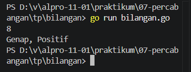
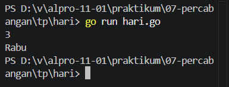
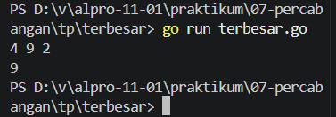

# <h1 align="center">Tugas Pendahuluan Modul [7] - [Percabangan]</h1>

[Varel Dwi Putra] - [109092600024]

### 1. Jelaskan perbedaan antara if, if-else, else if, dan switch pada bahasa pemrograman Go! Sebutkan juga dua perbedaan switch pada Go dibandingkan dengan switch pada Java. 

# <h1 align="center">"Jawab"</h1>

• if-else digunakan untuk memilih antara dua kemungkinan, yaitu kondisi benar atau salah.

• else if digunakan untuk memeriksa kondisi lain jika kondisi sebelumnya tidak terpenuhi.

• switch digunakan untuk memilih perintah berdasarkan nilai yang cocok dengan salah satu case.

Dua perbedaan switch pada Go dibandingkan dengan Java:

1. Pada Go, switch dapat digunakan tanpa ekspresi setelah kata switch, sehingga kondisi bisa ditulis langsung pada setiap case.

2. Pada Go, setiap case secara otomatis berhenti setelah dijalankan, sehingga tidak perlu menggunakan break seperti pada switch Java yang biasa.

### 2. Bilangan.go

package main

import "fmt"

func main() {
    var n int
    fmt.Scan(&n)

    if n == 0 {
        fmt.Println("Nol")
    } else {
        if n%2 == 0 {
            fmt.Print("Genap, ")
        } else {
            fmt.Print("Ganjil, ")
        }

        if n > 0 {
            fmt.Println("Positif")
        } else {
            fmt.Println("Negatif")
        }
    }
}

### output

### Deskripsi
Program yang menerima sebuah bilangan bulat, kemudian menentukan apakah bilangan tersebut genap atau ganjil serta positif atau negatif.

### 3. Hari.go

package main

import "fmt"

func main() {
    var hari int
    fmt.Scan(&hari)

    switch hari {
    case 1:
        fmt.Println("Senin")
    case 2:
        fmt.Println("Selasa")
    case 3:
        fmt.Println("Rabu")
    case 4:
        fmt.Println("Kamis")
    case 5:
        fmt.Println("Jumat")
    case 6:
        fmt.Println("Sabtu (akhir pekan)")
    case 7:
        fmt.Println("Minggu (akhir pekan)")
    default:
        fmt.Println("Nomor hari tidak valid")
    }
}

### output

### Deskripsi
Program dalam bahasa Go menggunakan switch yang menerima nomor hari (1–7) dan menampilkan nama harinya, dengan 1 = Senin hingga 7 = Minggu. Untuk hari Sabtu dan Minggu, tambahkan keterangan (akhir pekan). Jika nomor di luar 1–7, tampilkan Nomor hari tidak valid. 

### 4. Terbesar.go

package main

import "fmt"

func main() {
    var a, b, c int
    fmt.Scan(&a, &b, &c)

    if a >= b && a >= c {
        fmt.Println(a)
    } else if b >= a && b >= c {
        fmt.Println(b)
    } else {
        fmt.Println(c)
    }
}

### output

### Deskripsi
Program yang dibuat untuk menentukan bilangan terbesar dari tiga bilangan bulat yang diinputkan menggunakan percabangan if-else (tanpa perulangan dan tanpa fungsi bawaan max). 

## Kesimpulan
Berdasarkan tugas pendahuluan Modul 07, saya mempelajari penggunaan percabangan dalam bahasa Go untuk menentukan hasil berdasarkan kondisi tertentu. Percabangan "if-else" dapat digunakan untuk menentukan jenis bilangan dan mencari bilangan terbesar, sedangkan "switch" digunakan untuk menentukan nama hari berdasarkan nomor yang dimasukkan. Dari soal-soal tersebut, saya menjadi lebih memahami cara menggunakan percabangan untuk menyelesaikan masalah sederhana dalam pemrograman.