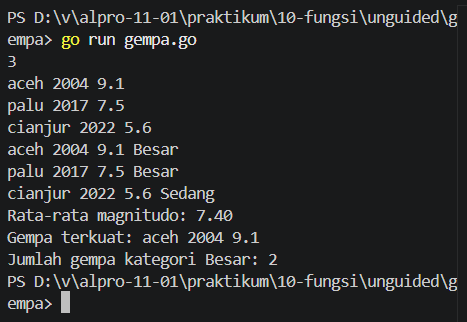

# <h1 align="center">Laporan Praktikum Modul [10] - [Fungsi]</h1>

[Varel Dwi Putra] - [109092600024]

## Dasar Teori

### A. Pemrograman Modular
Pemrograman modular merupakan cara membuat program dengan membagi program yang besar menjadi beberapa bagian kecil. Setiap bagian memiliki tugas masing-masing sehingga program lebih mudah dibuat, dipahami, dan diperbaiki.

### B. Pengertian Fungsi
Fungsi merupakan kumpulan instruksi yang dibuat untuk melakukan suatu proses dan menghasilkan nilai. Dalam bahasa Go, fungsi dibuat menggunakan kata kunci "func" dan biasanya menggunakan "return" untuk mengembalikan hasil.

### C. Deklarasi Fungsi pada Go
Fungsi dibuat di luar fungsi utama "main()". Dalam deklarasinya terdapat nama fungsi, parameter, tipe data hasil, dan perintah yang akan dijalankan.

### . Parameter Fungsi
Parameter merupakan variabel yang digunakan untuk menerima data dari program yang memanggil fungsi. Data tersebut digunakan sebagai masukan untuk menjalankan proses di dalam fungsi.

### 2. Return
"return" digunakan untuk mengembalikan hasil dari fungsi kepada program yang memanggilnya. Nilai yang dikembalikan harus sesuai dengan tipe data yang ditentukan pada deklarasi fungsi.

### D. Pemanggilan Fungsi
Fungsi dijalankan dengan cara memanggil nama fungsi beserta nilai atau variabel yang dibutuhkan oleh parameternya. Hasil fungsi dapat disimpan ke dalam variabel atau langsung ditampilkan menggunakan "fmt.Println()".

### E. Penggunaan Fungsi dalam Program
Fungsi dapat digunakan untuk berbagai perhitungan, seperti menghitung faktorial, permutasi, kombinasi, rata-rata, dan menentukan nilai terbesar. Dengan menggunakan fungsi, program menjadi lebih teratur karena setiap proses memiliki bagian tersendiri.

## Guided

### 1. Player.go
package main

import "fmt"

// Fungsi untuk mengecek tahun kabisat
func kabisat(tahun int) bool {
	return (tahun%4 == 0 && tahun%100 != 0) || (tahun%400 == 0)
}

// Fungsi untuk mengembalikan jumlah hari pada bulan tertentu dalam suatu tahun
func jumlahHari(bulan, tahun int) int {
	var hari int
	if bulan == 2 {
		if kabisat(tahun) {
			hari = 29
		} else {
			hari = 28
		}
	} else if bulan == 4 || bulan == 6 || bulan == 9 || bulan == 11 {
		hari = 30
	} else {
		hari = 31
	}
	return hari
}

// Fungsi untuk menghitung hari ke-berapa dalam tahun tersebut menggunakan perulangan
func hariKe(tanggal, bulan, tahun int) int {
	var total int = 0
	var i int
	for i = 1; i < bulan; i++ {
		total = total + jumlahHari(i, tahun)
	}
	total = total + tanggal
	return total
}

func main() {
	var tanggal, bulan, tahun int
	fmt.Scan(&tanggal, &bulan, &tahun)

	// Menghitung urutan hari dalam tahun
	urutanHari := hariKe(tanggal, bulan, tahun)

	// Menentukan jumlah total hari dalam satu tahun (kabisat = 366, biasa = 365)
	var totalHariTahun int
	if kabisat(tahun) {
		totalHariTahun = 366
	} else {
		totalHariTahun = 365
	}

	// Menghitung sisa hari hingga akhir tahun
	sisaHari := totalHariTahun - urutanHari

	// Menampilkan keluaran sesuai format
	fmt.Printf("Hari ke-%d\n", urutanHari)
	fmt.Printf("Sisa hari dalam tahun %d: %d\n", tahun, sisaHari)
}

### Deskripsi
Program ini digunakan untuk mengolah data skor player dalam sebuah turnamen game. Program dapat menghitung rata-rata skor, mencari player dengan skor tertinggi, dan menghitung jumlah player yang memiliki skor di atas rata-rata menggunakan fungsi.

## Unguided

### 1. Gempa.go
package main

import "fmt"

const NMAX = 999

type Gempa struct {
    nama string
    tahun int
    magnitudo float64
}

func kategori(m float64) string {
    if m < 4 {
        return "Minor"
    } else if m < 6 {
        return "Sedang"
    } else if m < 7 {
        return "Kuat"
    } else {
        return "Besar"
    }
}

func rataMagnitudo(T [NMAX]Gempa, n int) float64 {
    jumlah := 0.0

    for i := 0; i < n; i++ {
        jumlah = jumlah + T[i].magnitudo
    }

    return jumlah / float64(n)
}

func idxTerkuat(T [NMAX]Gempa, n int) int {
    idx := 0

    for i := 1; i < n; i++ {
        if T[i].magnitudo > T[idx].magnitudo {
            idx = i
        }
    }

    return idx
}

func hitungKategori(T [NMAX]Gempa, n int, k string) int {
    jumlah := 0

    for i := 0; i < n; i++ {
        if kategori(T[i].magnitudo) == k {
            jumlah++
        }
    }

    return jumlah
}

func main() {
    var T [NMAX]Gempa
    var n int

    fmt.Scan(&n)

    for i := 0; i < n; i++ {
        fmt.Scan(&T[i].nama, &T[i].tahun, &T[i].magnitudo)
    }

    for i := 0; i < n; i++ {
        fmt.Printf("%s %d %.1f %s\n",
            T[i].nama, T[i].tahun,
            T[i].magnitudo, kategori(T[i].magnitudo))
    }

    rata := rataMagnitudo(T, n)
    idx := idxTerkuat(T, n)
    besar := hitungKategori(T, n, "Besar")

    fmt.Printf("Rata-rata magnitudo: %.2f\n", rata)
    fmt.Printf("Gempa terkuat: %s %d %.1f\n",
        T[idx].nama, T[idx].tahun, T[idx].magnitudo)
    fmt.Println("Jumlah gempa kategori Besar:", besar)
}

##### Output

#### Deskripsi
Program ini digunakan untuk mengolah data gempa berdasarkan nama wilayah, tahun, dan magnitudo. Program dapat menentukan kategori gempa, menghitung rata-rata magnitudo, mencari gempa terkuat, serta menghitung jumlah gempa berdasarkan kategorinya.

## Kesimpulan
Berdasarkan praktikum Modul 10, saya mempelajari penggunaan fungsi dalam bahasa Go. Fungsi dapat digunakan untuk membagi program menjadi beberapa bagian sesuai tugasnya dan mengembalikan nilai menggunakan "return". Dari praktikum ini, saya lebih memahami cara membuat fungsi, menggunakan parameter, dan memanggil fungsi untuk menyelesaikan perhitungan seperti mencari rata-rata, nilai tertinggi, dan mengolah data.

## Referensi
1. Laboratorium Praktikum Informatika. (2025/2026). Modul Fungsi & Prosedur: Bab 9 Fungsi. Fakultas Informatika, Universitas Telkom.

2. Laboratorium Praktikum Informatika. (2025/2026). Jurnal Tugas Praktikum Modul 10: Fungsi – Bahasa Pemrograman Go (Golang). Fakultas Informatika, Universitas Telkom.

3. The Go Authors. (n.d.). The Go Programming Language Specification. https://go.dev/ref/spec
