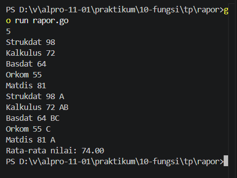
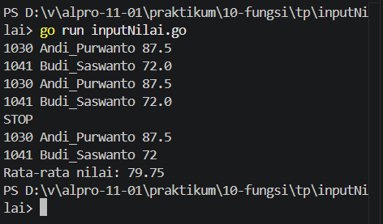

# <h1 align="center">Tugas Pendahuluan Modul [10] - [Fungsi]</h1>

[Varel Dwi Putra] - [109092600024]

### 1. Rapor.go
package main

import "fmt"

const NMAX = 999

type raport struct {
	matkul string
	nilai int
}

type tabRapot [NMAX]raport

func nilaiHuruf(x int) string {
	if x > 80 {
		return "A"
	} else if x > 70 {
		return "AB"
	} else if x > 65 {
		return "B"
	} else if x > 60 {
		return "BC"
	} else if x > 50 {
		return "C"
	} else if x > 40 {
		return "D"
	} else {
		return "E"
	}
}

func rataRata(T tabRapot, n int) float64 {
	total := 0

	for i := 0; i < n; i++ {
		total = total + T[i].nilai
	}

	return float64(total) / float64(n)
}

func main() {
	var T tabRapot
	var n int

	fmt.Scan(&n)

	for i := 0; i < n; i++ {
		fmt.Scan(&T[i].matkul, &T[i].nilai)
	}

	for i := 0; i < n; i++ {
		fmt.Println(T[i].matkul, T[i].nilai, nilaiHuruf(T[i].nilai))
	}

	fmt.Printf("Rata-rata nilai: %.2f\n", rataRata(T, n))
}

### Output

### Deskripsi
Program ini dibuat untuk mengolah data raport mahasiswa. Program menerima input berupa nama mata kuliah dan nilai angka, kemudian mengubah nilai angka menjadi nilai huruf menggunakan fungsi nilaiHuruf(). Selanjutnya, program menghitung rata-rata seluruh nilai mata kuliah menggunakan fungsi rataRata() dan menampilkan hasilnya ke layar.

### 2. inputNilai.go
package main

import "fmt"

const NMAX = 100

type student struct {
	nim string
	name string
	grade float64
}

type students [NMAX]student

func cariNIM(T students, n int, nim string) int {
	for i := 0; i < n; i++ {
		if T[i].nim == nim {
			return i
		}
	}
	return -1
}

func rataRata(T students, n int) float64 {
	total := 0.0

	for i := 0; i < n; i++ {
		total = total + T[i].grade
	}

	return total / float64(n)
}

func main() {
	var T students
	var n int
	var nim, name string
	var grade float64

	n = 0

	for {
		fmt.Scan(&nim)

		if nim == "STOP" {
			break
		}

		fmt.Scan(&name, &grade)

		if cariNIM(T, n, nim) == -1 {
			T[n].nim = nim
			T[n].name = name
			T[n].grade = grade
			n++
		}
	}

	for i := 0; i < n; i++ {
		fmt.Println(T[i].nim, T[i].name, T[i].grade)
	}

	if n > 0 {
		fmt.Printf("Rata-rata nilai: %.2f\n", rataRata(T, n))
	}
}

### Output

### Deskripsi
Program ini digunakan untuk menginput data mahasiswa berupa NIM, nama, dan nilai ujian. Program memeriksa NIM menggunakan fungsi cariNIM() agar tidak terjadi data duplikat. Jika NIM sudah pernah dimasukkan, data tersebut tidak disimpan kembali. Setelah input selesai dengan mengetik STOP, program menampilkan data mahasiswa yang sudah bersih dan menghitung rata-rata nilai menggunakan fungsi rataRata().

## Kesimpulan
1. Fungsi merupakan subprogram yang digunakan untuk menyelesaikan tugas tertentu dan mengembalikan nilai.

2. Fungsi dapat membantu membuat program lebih terstruktur dan mudah dipahami.

3. Pada modul ini dipelajari penggunaan fungsi untuk mengubah nilai angka menjadi huruf, menghitung rata-rata, mencari NIM, dan menghindari data duplikat.