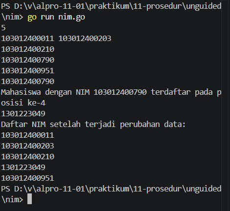

# <h1 align="center">Laporan Praktikum Modul [11] - [Prosedur]</h1>

[Varel Dwi Putra] - [109092600024]

## Dasar Teori

### A. Pemrograman Modular
Pemrograman modular adalah cara membagi program menjadi beberapa bagian kecil agar lebih mudah dibuat dan dipahami. Setiap bagian memiliki tugas tertentu dan dapat dipanggil ketika dibutuhkan oleh program utama.

### B. Pengertian Prosedur
Prosedur merupakan kumpulan instruksi yang dibuat untuk melakukan suatu proses tertentu. Berbeda dengan fungsi, prosedur tidak mengembalikan nilai menggunakan "return". Dalam bahasa Go, prosedur tetap dibuat menggunakan kata kunci "func", tetapi tidak memiliki tipe data hasil.

### C. Deklarasi Prosedur pada Go
Prosedur dibuat menggunakan kata kunci "func", diikuti nama prosedur dan parameter jika diperlukan. Prosedur dapat ditulis di luar fungsi utama "main()" dan dijalankan dengan cara dipanggil dari program utama.

### 1. Parameter Prosedur
Parameter digunakan untuk menerima data yang diberikan oleh program pemanggil. Parameter dapat digunakan untuk membaca data, mengolah data, maupun mengubah nilai tertentu.

### 2. Pass by Value
Pass by value merupakan cara mengirimkan data dengan memberikan salinan nilai ke dalam parameter. Perubahan pada parameter tidak mengubah nilai variabel asli yang berada di program pemanggil.

### 3. Pass by Reference
Pass by reference merupakan cara mengirimkan alamat memori suatu variabel menggunakan pointer. Dengan cara ini, perubahan yang dilakukan di dalam prosedur dapat memengaruhi variabel asli.

### D. Pemanggilan Prosedur
Prosedur dijalankan dengan menuliskan nama prosedur beserta argumen yang dibutuhkan. Prosedur hanya akan berjalan ketika dipanggil oleh program utama atau prosedur lainnya.

### E. Penggunaan Prosedur dalam Program
Prosedur dapat digunakan untuk melakukan berbagai proses, seperti membaca data, menampilkan hasil, mengubah nilai variabel, mencari data, dan menggeser isi array. Penggunaan prosedur membuat program lebih teratur karena setiap proses memiliki tugas masing-masing.

## Guided

### 1. Sapi.go
package main

import "fmt"

const NMAX = 10000

type Arr [NMAX]int

func mengisiSapi(T *Arr, n int) {
	for i := 0; i < n; i++ {
		fmt.Scan(&T[i])
	}
}

func geserKanan(T *Arr, n int) {
	var temp int = T[n-1]

	for i := n - 1; i > 0; i-- {
		T[i] = T[i-1]
	}

	T[0] = temp
}

func cetak(T Arr, n int) {
	for i := 0; i < n; i++ {
		fmt.Print(T[i], " ")
	}
	fmt.Println()
}

func main() {
	var n, k int
	fmt.Scan(&n, &k)

	var T Arr
	mengisiSapi(&T, n)

	k = k % n

	for i := 0; i < k; i++ {
		geserKanan(&T, n)
	}

	cetak(T, n)

}

### Deskripsi
Program ini digunakan untuk mencari NIM mahasiswa di dalam array. Jika NIM ditemukan, program akan mengganti NIM tersebut dengan NIM baru dan menampilkan kembali seluruh daftar NIM setelah perubahan.

## Unguided

### 1. Nim.go
package main

import "fmt"

const NMAX = 2002

func cariNIM(T [NMAX]int, n, x int, idx *int) {
    *idx = -1

    for i := 0; i < n; i++ {
        if T[i] == x {
            *idx = i
            break
        }
    }
}

func ubahNIM(T *[NMAX]int, idx, baru int) {
    T[idx] = baru
}

func cetak(T [NMAX]int, n int) {
    for i := 0; i < n; i++ {
        fmt.Println(T[i])
    }
}

func main() {
    var T [NMAX]int
    var n, cari, baru, idx int

    fmt.Scan(&n)

    for i := 0; i < n; i++ {
        fmt.Scan(&T[i])
    }

    fmt.Scan(&cari)

    cariNIM(T, n, cari, &idx)

    if idx != -1 {
        fmt.Printf("Mahasiswa dengan NIM %d terdaftar pada posisi ke-%d\n", cari, idx+1)

        fmt.Scan(&baru)

        ubahNIM(&T, idx, baru)

        fmt.Println("Daftar NIM setelah terjadi perubahan data:")
        cetak(T, n)
    } else {
        fmt.Println("NIM tidak ditemukan dalam sistem")
    }
}

##### Output

#### Deskripsi
Program ini digunakan untuk mencari NIM mahasiswa di dalam array. Jika NIM ditemukan, program akan mengganti NIM tersebut dengan NIM baru dan menampilkan kembali seluruh daftar NIM setelah perubahan.

## Kesimpulan
Berdasarkan praktikum Modul 11, saya mempelajari penggunaan prosedur dalam bahasa Go untuk menjalankan suatu proses tanpa mengembalikan nilai. Prosedur dapat digunakan untuk membaca data, mengubah isi array, mencari NIM, dan menampilkan hasil program. Dari praktikum ini, saya lebih memahami cara membuat dan memanggil prosedur serta penggunaan parameter dan pointer untuk mengubah data.

## Referensi
1. Laboratorium Praktikum Informatika. (2025/2026). Modul Fungsi & Prosedur: Bab 10 Prosedur. Fakultas Informatika, Universitas Telkom.

2. Laboratorium Praktikum Informatika. (2025/2026). Jurnal Tugas Praktikum Modul 11: Prosedur – Bahasa Pemrograman Go (Golang). Fakultas Informatika, Universitas Telkom.

3. The Go Authors. (n.d.). The Go Programming Language Specification. https://go.dev/ref/spec
