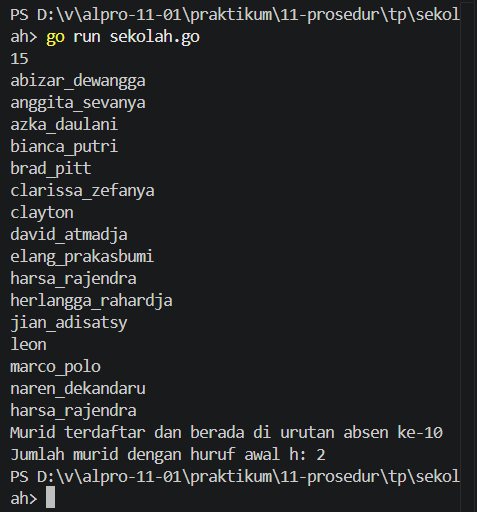
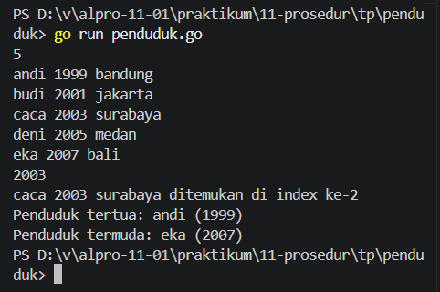

# <h1 align="center">Tugas Pendahuluan Modul [10] - [Fungsi]</h1>

[Varel Dwi Putra] - [109092600024]

### 1. Sekolah.go
package main

import "fmt"

const NMAX = 1001

type tabMurid [NMAX]string

func cariMurid(T tabMurid, n int, nama string, posisi *int, ketemu *bool) {
	*ketemu = false
	*posisi = -1

	for i := 0; i < n; i++ {
		if T[i] == nama {
			*ketemu = true
			*posisi = i + 1
			break
		}
	}
}

func hitungHuruf(T tabMurid, n int, h byte, jumlah *int) {
	*jumlah = 0

	for i := 0; i < n; i++ {
		if T[i][0] == h {
			*jumlah = *jumlah + 1
		}
	}
}

func main() {
	var T tabMurid
	var n int
	var nama string
	var posisi, jumlah int
	var ketemu bool

	fmt.Scan(&n)

	for i := 0; i < n; i++ {
		fmt.Scan(&T[i])
	}

	fmt.Scan(&nama)

	cariMurid(T, n, nama, &posisi, &ketemu)

	if ketemu {
		fmt.Printf("Murid terdaftar dan berada di urutan absen ke-%d\n", posisi)
	} else {
		fmt.Println("Murid tidak terdaftar")
	}

	hitungHuruf(T, n, nama[0], &jumlah)

	fmt.Printf("Jumlah murid dengan huruf awal %c: %d\n", nama[0], jumlah)
}

### output

### Deskripsi
Program ini digunakan untuk mencari nama murid dalam daftar absen sekolah. Program menggunakan prosedur cariMurid() untuk memeriksa apakah nama murid terdaftar dan mengetahui posisi absennya. Selain itu, prosedur hitungHuruf() digunakan untuk menghitung jumlah murid yang memiliki huruf awal sama dengan nama yang dicari.

### 2. Penduduk.go 
package main

import "fmt"

const NMAX = 1000

type penduduk struct {
	nama string
	tahun int
	kota string
}

type tabPenduduk [NMAX]penduduk

func cariTahun(T tabPenduduk, n, th int, idx *int) {
	*idx = -1

	for i := 0; i < n; i++ {
		if T[i].tahun == th {
			*idx = i
			break
		}
	}
}

func tertuaTermuda(T tabPenduduk, n int, tua, muda *penduduk) {
	*tua = T[0]
	*muda = T[0]

	for i := 1; i < n; i++ {
		if T[i].tahun < tua.tahun {
			*tua = T[i]
		}

		if T[i].tahun > muda.tahun {
			*muda = T[i]
		}
	}
}

func main() {
	var T tabPenduduk
	var n, th, idx int
	var tua, muda penduduk

	fmt.Scan(&n)

	for i := 0; i < n; i++ {
		fmt.Scan(&T[i].nama, &T[i].tahun, &T[i].kota)
	}

	fmt.Scan(&th)

	cariTahun(T, n, th, &idx)

	if idx != -1 {
		fmt.Printf("%s %d %s ditemukan di index ke-%d\n",
			T[idx].nama, T[idx].tahun, T[idx].kota, idx)
	} else {
		fmt.Println("Data tidak ditemukan")
	}

	tertuaTermuda(T, n, &tua, &muda)

	fmt.Printf("Penduduk tertua: %s (%d)\n", tua.nama, tua.tahun)
	fmt.Printf("Penduduk termuda: %s (%d)\n", muda.nama, muda.tahun)
}

### output

### Deskripsi
Program ini digunakan untuk menyimpan dan mencari data penduduk berdasarkan tahun lahir. Prosedur cariTahun() digunakan untuk mencari penduduk berdasarkan tahun lahir yang dimasukkan. Sedangkan prosedur tertuaTermuda() digunakan untuk menentukan penduduk yang paling tua dan paling muda berdasarkan tahun lahir. Hasil pencarian dan data penduduk tertua serta termuda kemudian ditampilkan ke layar.

## Kesimpulan
1. Prosedur merupakan subprogram yang digunakan untuk menjalankan perintah tanpa mengembalikan nilai.

2. Prosedur dapat menggunakan parameter pointer agar hasil perubahan bisa digunakan di program utama.

3. Pada modul ini dipelajari penggunaan prosedur untuk mencari data murid, menghitung jumlah nama berdasarkan huruf awal, mencari tahun lahir, serta menentukan penduduk tertua dan termuda.